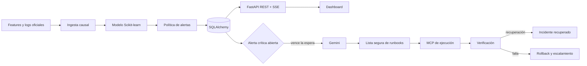

# Zikit Sentinel — Backend

Backend AIOps para detectar incidentes antes de su impacto, emitir alertas causales y ejecutar remediaciones seguras en una infraestructura controlada.

## Arquitectura



El detector es independiente de Gemini. Gemini no cambia el score ni crea comandos: solamente selecciona un identificador existente en el catálogo versionado. El servidor MCP vuelve a validar que el runbook sea preautorizado y reversible antes de ejecutarlo.

## Flujo

1. La ingesta procesa únicamente información disponible hasta el minuto evaluado.
2. El modelo y la política generan alertas con `tenant`, `timestamp`, `confidence` y tipo de incidente opcional.
3. Las alertas se guardan de forma idempotente y se publican por REST y SSE.
4. Una alerta crítica sin atender espera el plazo configurado.
5. Gemini selecciona un runbook permitido; si no está disponible, el incidente se escala sin ejecutar cambios.
6. MCP aplica la acción sobre la infraestructura controlada.
7. Sentinel verifica CPU, errores y latencia; registra recuperación o revierte y escala.
8. La decisión, acción, verificación y resultado quedan disponibles en JSON y CSV.

## Tecnologías

| Área | Tecnología |
|---|---|
| API y streaming | FastAPI, Uvicorn, Server-Sent Events |
| Datos y modelo | Pandas, NumPy, PyArrow, Scikit-learn, Joblib |
| Persistencia | SQLAlchemy, SQLite o PostgreSQL |
| IA | Google Gen AI (`gemini-3.7-flash`) |
| Herramientas | Model Context Protocol (MCP) |
| Validación | Pytest, hashes SHA-256 y auditorías reproducibles |
| Despliegue | Docker, Railway |

## Instalación

Requisitos: Python 3.12–3.14 y Git.

```bash
git clone git@github.com:Hydra115-code/zikit-2026.git zikit-2026
cd zikit-2026
python3.12 -m venv .venv
.venv/bin/pip install -e '.[ai,test]'
cp .env.example .env
```

En `.env`, agrega tu clave sin espacios:

```env
GEMINI_API_KEY=tu_api_key
```

Los secretos locales están excluidos de Git.

## Ejecución

```bash
.venv/bin/uvicorn app.main:app --host 127.0.0.1 --port 8000
```

- API: `http://127.0.0.1:8000`
- OpenAPI: `http://127.0.0.1:8000/docs`
- Salud: `GET /health/ready`

La demostración completa se inicia desde el repositorio frontend con `pnpm demo:jury`.

## API principal

| Método | Ruta | Uso |
|---|---|---|
| `POST` | `/api/challenge/replay` | Procesa una corrida oficial |
| `POST` | `/api/challenge/live-replay` | Inicia un replay causal minuto a minuto |
| `GET` | `/api/challenge/live-replay/stream` | Telemetría y alertas por SSE |
| `GET` | `/api/challenge/alerts` | Alertas persistidas |
| `GET` | `/api/challenge/operations` | Estado operativo agregado |
| `GET` | `/api/challenge/remediations` | Estado y auditoría de remediaciones |
| `GET` | `/api/challenge/remediations/audit.csv` | Exportación de auditoría |

Las operaciones administrativas requieren `X-Admin-Token`.

## Configuración relevante

| Variable | Propósito | Valor predeterminado |
|---|---|---|
| `DATABASE_URL` | Base de datos | `sqlite:///./data/sentinel.db` |
| `ADMIN_TOKEN` | Protege operaciones administrativas | Solo desarrollo |
| `GEMINI_API_KEY` | Credencial de Gemini | Vacía |
| `GEMINI_MODEL` | Modelo de selección | `gemini-3.7-flash` en `.env.example` |
| `CHALLENGE_REMEDIATION_WAIT_SECONDS` | Espera antes de actuar | `300` |
| `CHALLENGE_REMEDIATION_VERIFICATION_MINUTES` | Ventana de verificación | `10` |
| `MCP_EXECUTION_URL` | MCP separado de ejecución | `http://127.0.0.1:8000/mcp-execution/` |

El catálogo seguro vive en `config/challenge_remediation_runbooks.json`.

## Verificación

```bash
.venv/bin/pytest -q
.venv/bin/python -m app.challenge.remediation_audit \
  --output data/challenge-phase-4 \
  --fail-on-gates
```

La auditoría cubre recuperación, respuesta del operador, indisponibilidad de Gemini y rollback. Los datos reservados del evaluador no forman parte del repositorio ni del flujo de predicción.
